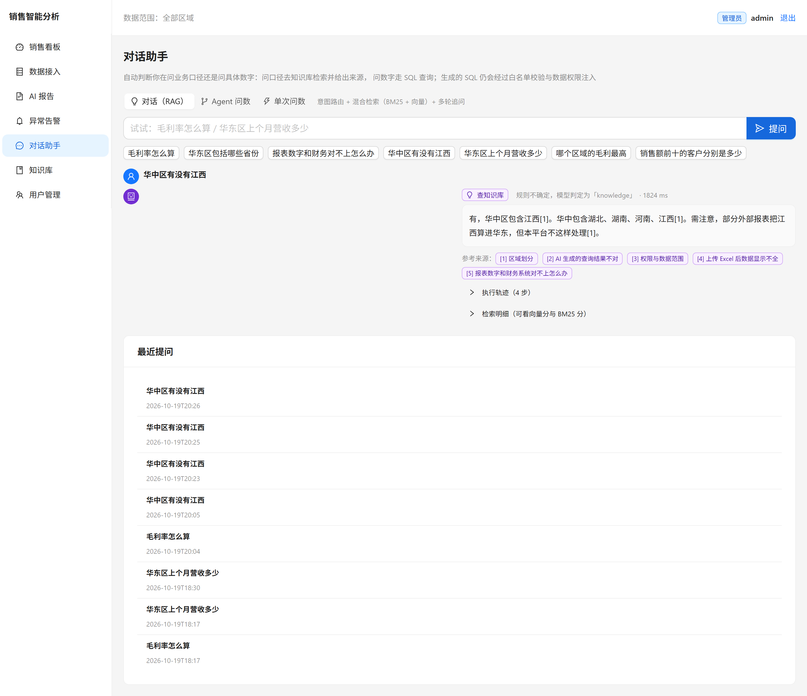
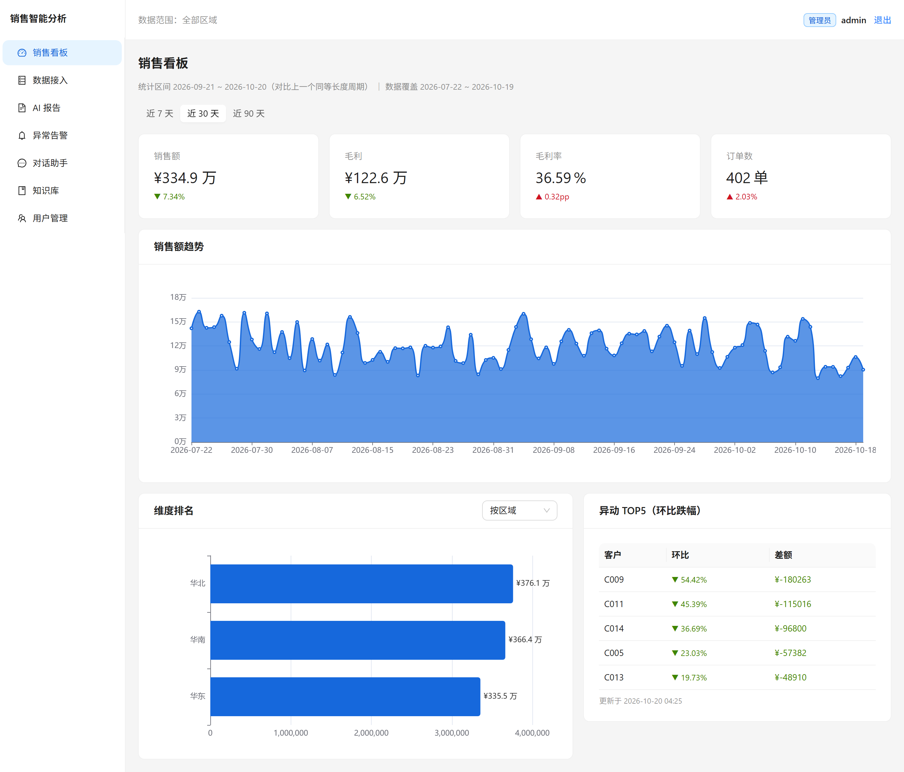
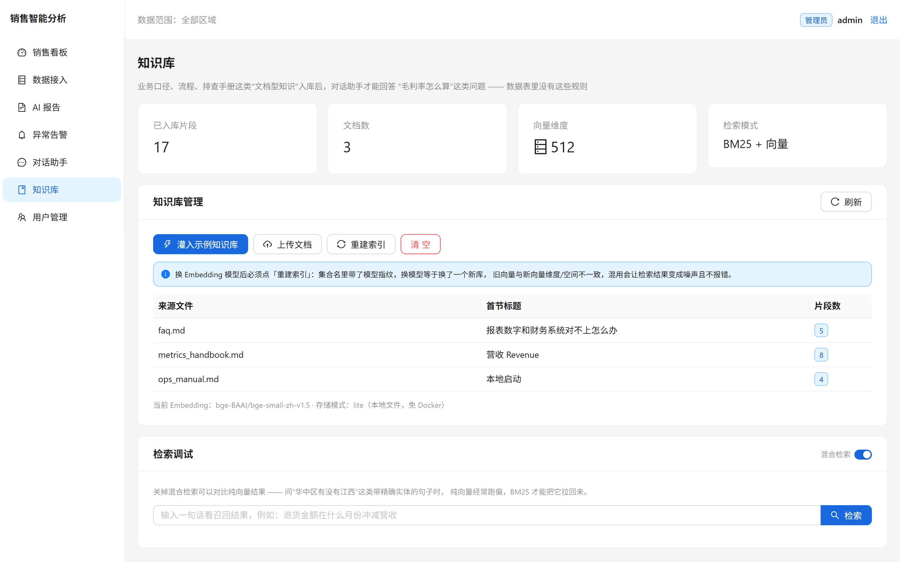
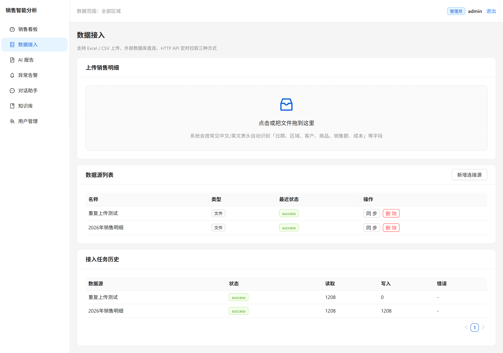
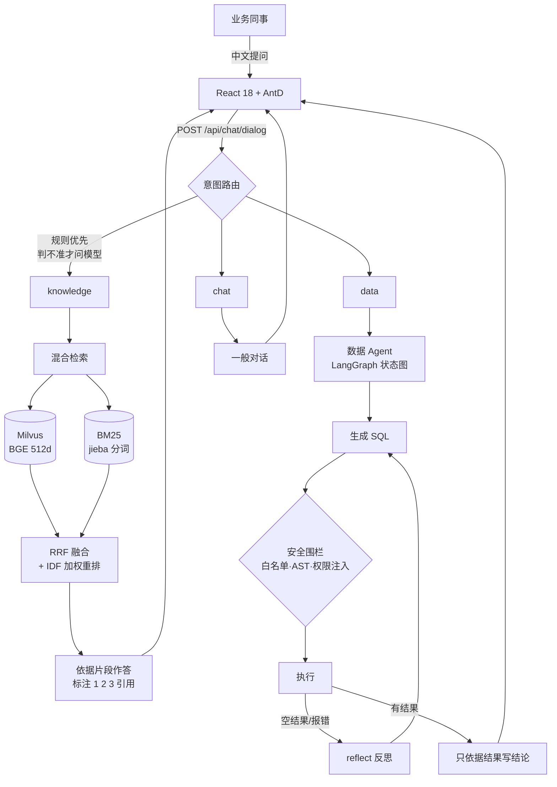
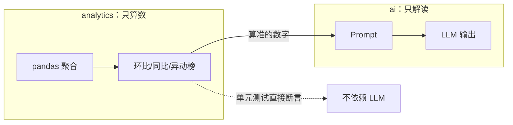
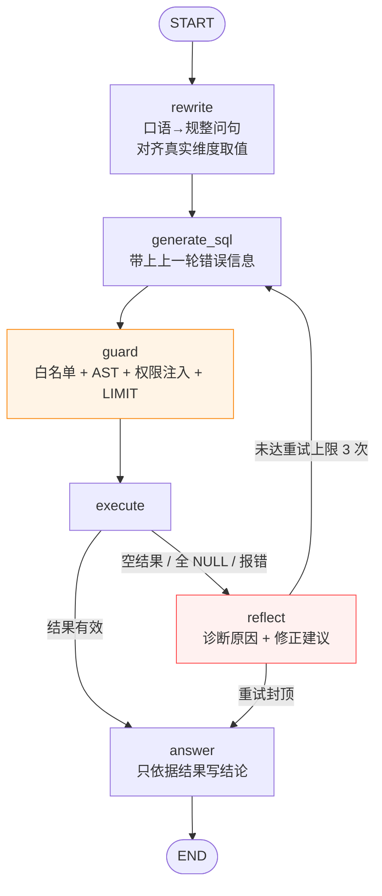

# Sales Insight · 企业销售智能分析平台

> 把销售数据接进来，让业务同事用**中文问数**、一键拿到**可开会的 AI 报告**，并对异常自动告警。
> 数据表答不了的规则类问题（"毛利率怎么算"），交给 **RAG 知识库**回答。

[](https://github.com/CTYQAQ/sales-insight/actions/workflows/ci.yml)




一句话说清它在做什么：用户问「华中区有没有江西」，系统判断这是**文档型问题**而不是查数，
去向量库召回「区域划分」那一段，回答里每个结论都带 `[1]` 这样的出处编号。

---

## 30 秒速览

| | |
|---|---|
| **规模** | 40 个 API 端点 · 50 个后端模块 · 6 个前端页面 |
| **Agent** | 3 套：会自我纠错的数据 Agent、意图路由对话 Agent、报告生成 |
| **RAG** | Milvus + BGE(512d) + BM25 混合检索，RRF 融合 + IDF 加权重排 |
| **测试** | 82 项，含 27 条 SQL 注入攻击载荷 |
| **技术栈** | FastAPI · SQLAlchemy 2.0 · LangGraph · React 18 · TypeScript · Ant Design 5 |

**这个项目最值得看的三处**（每一处都有对应的失败现场和实测数据）：

1. **不让模型编数字** —— 指标全部本地 SQL 先算准，LLM 只做解读；Text2SQL 把维度真实取值
   注入 Prompt，否则「华东区」对不上库里的「华东」，JOIN 落空返回 NULL，
   模型会对着 NULL 编出「该期间无销售数据」—— 看起来完全正常，实际少了 121 万。
2. **Agent 会自我纠错** —— LangGraph 状态图，空结果/报错时进 `reflect` 节点诊断原因再重试，重试封顶 3 次。
3. **检索降级必须报警** —— 混合检索里 BM25 一旦静默失效，排序变差但完全不报错。
   这个项目里踩过三种「降级不报警」，每一种都写了测试钉死。

---

## 功能截图

| 销售看板 | 对话助手 |
|---|---|
|  |  |
| **知识库管理** | **数据接入** |
|  |  |

> 截图由 `scripts/screenshot.mjs` 用 CDP 驱动本机 Edge 自动生成（零额外依赖，
> 不装 Playwright）。改了 UI 后 `node scripts/screenshot.mjs` 一键重拍。

---

## 五分钟跑起来

```bash
# 1. 后端
cd backend
python -m venv .venv && source .venv/bin/activate      # Windows: .venv\Scripts\activate
pip install -r requirements.txt
cp .env.example .env                                    # 填入 DEEPSEEK_API_KEY
python run.py                                           # → http://127.0.0.1:8000/api/docs

# 2. 前端（新开终端）
cd frontend && npm install && npm run dev               # → http://127.0.0.1:5173

# 3. 灌入示例知识库（登录后点「灌入示例文档」也行）
curl -X POST http://127.0.0.1:8000/api/knowledge/seed -H "Authorization: Bearer <token>"
```

默认账号 `admin / admin123`（种子数据自动创建，含约 1200 行演示销售明细）。

> **不想装 2GB 的 torch？** 默认的 `local` 哈希向量后端零依赖即可跑通全链路
> （代价是没有语义能力）。要真语义检索再按
> [「想用 BGE 跑真语义检索」](#想用-bge-跑真语义检索) 装。

---

## 架构



数据层与 AI 层是分开的，这是刻意的：



**分层原则**：`analytics` 只算数、`ai` 只解读，两者不混写。
这样指标算错和模型说错可以分别定位，也给单元测试留出了干净的切面。

---

## Agent：会自我纠错的数据问答

`POST /api/chat/agent/query`

问数最典型的失败不是报错，而是**静默给错答案**：用户问"华东区"，库里存的是"华东"，
JOIN 落空返回 `NULL`，模型便对着 NULL 编出一句"该期间无销售数据"——看起来完全合理，实际是错的。

单次「问题→SQL」的翻译没有翻盘机会。这里用 LangGraph 编成一张状态图，让它能自己发现并修正：



> `guard` 是橙色 —— 它**不经过 LLM**，用确定性代码守边界。
> `reflect` 是红色 —— 它是唯一的回头路，也是必须封顶的地方。

**每个节点只做一件事**，职责单一，出错时能一眼定位是"理解错了"还是"SQL 写错了"：

| 节点 | 职责 | 是否用 LLM |
|---|---|---|
| `rewrite` | 口语 → 规整问句；对齐维度真实取值（"华东区"→"华东"）；相对时间 → 明确日期 | 是 |
| `generate_sql` | 问句 → SQL；**带上上一轮的错误信息** | 是 |
| `guard` | 白名单 + AST 校验 + 权限注入 + LIMIT 兜底 | **否（纯代码）** |
| `execute` | 执行并判定「空结果 / 全 NULL」 | 否 |
| `reflect` | 分析失败原因，输出"原因 + 修正建议" | 是 |
| `answer` | 只依据查询结果写结论 | 是 |

**为什么用图而不是一个 for 循环：**
1. **路由显式化** —— 失败后去哪、何时停手写在边上，审阅时一眼看懂，改流程不必动节点内部。
2. **状态可观测** —— 每个节点返回增量，`trace` 可逐步回放，精确定位到某一节点。
3. **可插拔** —— 以后加人工确认、缓存命中直出、并行多候选 SQL，都是加节点加边。

**三个刻意的设计取舍：**
- **重试必须封顶**（默认 3 次）。没有上限的自我反思就是无限循环 + 无限烧 token。
  次数用尽后不会抛错，而是走到 `answer` 如实说明"没查到"，让用户知道发生了什么。
- **安全闸门不过 LLM**。`guard` 由确定性代码守边界，不能指望模型"自觉"。
- **反思结论必须回传**。不带错误信息重试，模型只会把同一个错误再犯一遍——
  `tests/test_agent_graph.py` 专门断言了这一点。

> 对比：旧的 `/chat/query` 仍然保留（单次翻译）。两个接口并存，方便直接对比 effect。

---

## 对话 Agent：意图路由 + RAG + 多轮记忆

`POST /api/chat/dialog`

数据 Agent 只会回答"数字是多少"。但业务同事真正会问的还有一半是**规则类问题**：
"毛利率怎么算""华东区包含哪些省份""报表和财务对不上怎么办"。
这些问题数据表里没有答案 —— 它们是**文档型知识**。

所以又加了一层对话 Agent，先判断意图，再分流：

```mermaid
flowchart TD
    S([START]) --> UN[understand<br/>指代消解]
    UN --> RT{route<br/>规则优先}

    RT -->|knowledge| RE[retrieve<br/>BM25 + 向量]
    RE --> KB[answer_kb<br/>严格依据片段<br/>标注引用]
    RT -->|data| DA[answer_data<br/>复用数据 Agent<br/>含自纠错]
    RT -->|chat| CH[answer_chat]

    KB --> E([END])
    DA --> E
    CH --> E

    UN -.->|"那华南呢"<br/>→ "华南区2026年9月营收多少？"| UN2[继承上一轮的时间与指标]

    style RT fill:#e6f4ff,stroke:#1677ff
```

| 节点 | 职责 | 是否用 LLM |
|---|---|---|
| `understand` | 把省略式追问补成独立问句；问句已完整则直接跳过（省一次调用） | 是（按需） |
| `route` | 意图分类：knowledge / data / chat | **规则优先**，判不准才叫模型 |
| `retrieve` | BM25 + 向量混合检索，RRF 融合 + 覆盖率重排 | 否 |
| `answer_kb` | 严格依据片段作答，正文标注 `[1][2]` 引用 | 是 |
| `answer_data` | 调用数据 Agent（自纠错），复用同一套安全围栏 | 是（内部） |
| `answer_chat` | 一般对话，并适时引导到业务问题 | 是 |

### 为什么混合检索，而不是纯向量

纯向量和纯 BM25 各有硬伤，而且**正好互补**：

| | 强项 | 硬伤 |
|---|---|---|
| 纯向量 | 语义相似，"营收"≈"销售额" | 记不住精确实体："华北-2024Q3"、产品型号 |
| 纯 BM25 | 字面命中，精确、可解释 | 同义改写直接归零 |

业务知识库里恰恰全是"毛利率""华中区""退货率"这类精确术语，纯向量经常召回一堆
语义相近但答非所问的片段。

**融合用 RRF（Reciprocal Rank Fusion）而不是加权求和**，原因是量纲不可比：
BM25 分数无上界（随语料变化），余弦相似度在 [-1,1]。直接相加等于让 BM25 单方面主导，
权重根本调不出来。RRF 只用排名 `Σ 1/(k+rank)`，免疫量纲，且无需调参。

**实测结论要说清楚（避免夸大）**：混合检索的价值取决于 embedding 后端。

| embedding 后端 | 混合 vs 纯向量的 Top1 |
|---|---|
| `local`（哈希，无语义） | 混合明显更优 —— 这就是最初做混合的动力 |
| `bge`（真语义） | 4 条测试查询**结果完全一致** |

原因不难理解：混合检索本质是在补纯向量的短板。换了 BGE 之后向量本身已经能抓住
"华东区"这类实体，BM25 就不再是救场的角色。

> 但 BM25 **并没有闲置**：它仍在参与 RRF 融合与重排，
> 实测 BM25 分数是非零的（「华中区有没有江西」6.78、「退货金额在什么月份冲减营收」9.48）。
> 只是在这个语料规模下，它和向量给出的排序恰好一致，所以最终 Top1 没变。
> 到更大规模、更多生僻型号/编号的语料上，BM25 的价值会重新显现。
>
> 保留 `RAG_HYBRID` 这个开关，正是为了能随时做这种对照实验。

实测证据（`local` 后端，`/api/knowledge/search?q=华中区有没有江西`）：

| | Top1 |
|---|---|
| 纯向量 | 上传 Excel 后数据显示不全 ❌ |
| 混合 | 区域划分 ✅（BM25 6.62，覆盖率 100%） |

### 中文检索踩过的三个坑（都是真调试出来的）

1. **`华东区` ≠ `华东`** — jieba 把"华东区"当一个词，语料写的是"华东"。
   差一个字，BM25 全落空。解法：切词后按领域后缀（区/省份/品类…）额外产出一个词形变体。
2. **同义词重复计分** — "华东区"和"华东"若各算一个词，碰巧写了两种写法的长文档会白拿两分。
   解法：`query_terms()` 对同一组变体只保留最短的当代表。
3. **`has_collection` 为真但检索报 released** — Milvus 集合 reload 后处于 released 状态，
   `query()` 需要先 `load_collection()`。之前这里 `except` 后只打 warning 就返回空，
   导致 **BM25 静默退化成空**、混合检索悄悄变回纯向量 —— 完全不报错，排序质量下降但查不出原因。

### 重排环节踩过的三个坑（换了 BGE 之后才暴露出来）

这几条比上面更隐蔽：**不做也不报错，只是排序悄悄变差**。

1. **疑问词进了覆盖率分母。**
   「报表和财务对不上怎么办」被切成 `{报表, 财务, 对不上, 怎么办}`，
   "怎么办"不是实体，却占了一整份权重，把覆盖率压到 0.25 左右，
   正确答案反而排不到第一。解法：把疑问/引导词（怎么办、返回、为什么、包括…）
   统一进停用词表。

2. **覆盖率没有 IDF 意识。**
   问「导入表格丢数据了」，命中的是 `{导入, 表格, 数据}`，而"数据"这个词几乎每篇文档都有 ——
   **命中一个随处可见的词，和命中一个独有实体，在朴素覆盖率里权重完全一样**。
   结果向量已经排对了（上传 Excel 0.549，领先），重排却把它压到第二。
   解法：覆盖率改成按 IDF 加权，越稀有的概念命中越算数。

3. **覆盖率不该无条件压过向量分。**
   即使加了 IDF，上面那条问题仍可能在 borderline 情况下翻车。
   最终定下的规则是：**向量分跨度 > 0.06 时信任向量**（语义已分出高下），
   跨度接近时才交给覆盖率/topic 决定。
   但这个信任只对**真语义模型**成立 —— `local` 哈希后端的向量分纯靠字符重叠，
   差异不代表语义质量，所以按 `emb.name` 判断，哈希后端一律不启用该分支。

> 第 3 条还带来一个意外收获：修完之后 `bge` 后端的 Top1 命中从 7/8 变成 8/8，
> 而 `local` 仍是 7/8 —— 差距刚好落在"同义改写"这一类问题上，符合预期。

### 多轮记忆怎么做

不用 LangGraph checkpointer，而是**前端带最近 6 轮 history**。理由很实际：
本项目是单机无状态部署，把会话存数据库比放进程内存更稳 —— 重启不丢、多 worker 不串。
checkpointer 更适合需要"中断-恢复"的长流程 Agent，这里用不上。

真正的难点不是存历史，而是**指代消解**：用户极少把话说全。
"那上个月呢"直接丢给检索或 Text2SQL，两个分支都会答错。
实测：`「那华南呢」→「华南区2026年9月营收多少？」`，自动继承了"上个月"和"营收"。

### Embedding 的选型说明

| 后端 | 说明 |
|---|---|
| `local`（默认） | 字符 n-gram 哈希 + L2 归一化。**零依赖、确定性**，用于跑通链路和单测。**没有语义能力** |
| `bge` | 本地 BGE 小模型（`sentence-transformers`），24M 参数 / 512 维，CPU 上单条几十毫秒 |
| `api` | 任何 OpenAI 兼容 `/embeddings` |

> 踩坑：DeepSeek **只提供对话模型，没有 embedding 接口**（`/embeddings` 返回 404）。
> 所以默认走本地实现，`EmbeddingProvider` 做成可插拔，换模型只改 `.env` 一行。

**换 BGE 前后的实测差异**（同一批语料、同一个 query，只换 embedding 后端）：

| 查询 | `local` Top1 | `bge` Top1 |
|---|---|---|
| 利润率的算法是什么 | 毛利率 ✅（但置信度仅 0.12） | 毛利率 ✅（**0.65**） |
| 销售业绩不好怎么算比例 | 上传 Excel 丢数据 ❌ | 退货率 ✅ |
| 江西属于哪个区 | 华中区 ✅（0.11） | 华中区 ✅（**0.58**） |
| 导入表格丢数据了 | 上传 Excel 丢数据 ✅（0.09） | 上传 Excel 丢数据 ✅（**0.56**） |

**端到端 Top1 命中率**（8 条真实业务问句，同一套混合检索 + 重排逻辑）：

| embedding | Top1 命中 | 漏掉的是哪条 |
|---|---|---|
| `bge` | **8 / 8** | — |
| `local` | 7 / 8 | 「导入表格丢数据了」→ 错召回「数据更新频率」 |

结论很清楚：**`local` 只是让链路跑通的脚手架**，真做检索必须换模型。
相似度绝对值从 0.1 量级跳到 0.5–0.65 量级，意味着排序终于有区分度了；
唯一的差距正好落在一条纯同义改写上（表格≈Excel、导入≈上传），
而这恰好是哈希算法唯一做不到的事。

> 这些结论都写进了 `tests/test_rag.py`：
> 「哈希在同义改写上相似度普遍低于 0.3」「BGE 能把语义相近的排第一」
> 「哈希后端不许让向量分主导排序」。BGE 相关用例在模型未下载时自动 `skip`。

**BGE 的两个不对称细节**（错了不报错，只是效果悄悄变差）：

1. **query 侧要加指令前缀** `为这个句子生成表示以用于检索相关文章：`，passage 侧不加。
   所以 provider 接口里分了 `encode()` 和 `encode_query()` 两个方法，检索侧统一走后者。
2. **必须 L2 归一化**。`normalize_embeddings=True` 让余弦和点积结果一致，换度量方式不翻车。

**模型怎么下**（国内网络）：

```bash
# 方案一：HF 镜像（注意 hf-mirror 对大文件的 Xet 协议支持不全，可能 401）
export HF_ENDPOINT=https://hf-mirror.com

# 方案二：ModelScope（实测更稳，本项目用的这个）
pip install modelscope
python -c "from modelscope import snapshot_download; \
  snapshot_download('BAAI/bge-small-zh-v1.5', cache_dir='./models')"
```

下载后把 `EMBEDDING_BACKEND` 改成 `bge` 即可。`BGELocalEmbedding._resolve_local()`
会同时识别 HF 和 ModelScope 两种落盘结构，找到本地目录就不再去联网校验。

**换模型后必须重建索引**：集合名里带了模型指纹，换模型等于换了一个新集合。
新旧向量混用维度/空间不一致，检索结果会变成噪声 —— 而且不报错，极难排查。

> 另一处静默降级：`EMBEDDING_BACKEND` 写成不认识的值（如 `bgge`）时，
> 旧代码只打 `warning` 就退回 `local`。用户以为在用 BGE，实际在跑哈希向量，
> "换了模型怎么没效果"。现在改成 `error` 级并写明可选值，也用测试锁住了。

### Milvus 部署：lite 还是 standalone

同一个 `MILVUS_CONN` 配置决定形态，业务代码完全不动：

- `./milvus.db` — lite，本地文件，**免 Docker**，本项目默认。同一时间只能一个进程用。
- `http://127.0.0.1:19530` — standalone，需 Docker，支持多实例与大数据量。

> 踩坑一：配置项**不能叫 `MILVUS_URI`**。pymilvus 3.x 在 `import` 阶段就用这个环境变量
> 初始化模块级单例并校验格式（只认 `http(s)://`），lite 的文件路径会被判非法，
> 连业务代码都还没跑到就抛 `ConnectionConfigException`。
>
> 踩坑二：相对路径必须钉成绝对路径。`MILVUS_CONN=./milvus.db` 在 uvicorn 里解析到
> `backend/milvus.db`，在 pytest 里可能解析到别处 —— 表现为"入库成功了，检索却是空的"。

---

## 为什么值得看：三个真实难点

很多 AI 项目停留在"调通 OpenAI SDK + Prompt 拼接"。这个项目想证明的是**让 LLM 安全产出可信结果**的那部分工程能力。

### 1. 不让模型忽悠人：Grounding + 防幻觉

AI 应用最大的坑不是跑不通，而是**跑通了但结果是编的**。

- **报告生成：LLM 只负责解读，不负责算数。**
  核心指标、环比、维度拆解、异动榜，全部由本地 SQL 先算准，再连同数据一起喂给模型去做**解读**。
  报告里每一个百分比都能回溯到本地聚合结果，模型没有制造数字的机会。

- **Text2SQL：把维度真实取值喂进 Prompt。**
  只给表结构的话，模型只能靠常识猜取值 —— 用户问"华东区"，它会写 `dr.name = '华东区'`，
  而库里存的是 **`华东`**（不带"区"）→ JOIN 落空返回 `NULL` → 模型对着 NULL 编出"该期间无销售记录"。
  **结论看起来完全正常，实际是错的**，而真实数据是 121 万。

  修复方式是把 `dim_region / dim_customer / dim_product / channel` 的真实取值动态注入 System Prompt，
  并写死规则「说法不一致时取最接近的真实值，**严禁臆造**，拿不准用 LIKE」。带 5 分钟缓存与超量截断兜底。

- **失败必须显式报错，绝不返回错误字符串冒充内容。**
  Provider 层契约：要么返回结构化结果，要么抛异常。上游故障不会伪装成一份残缺报告流向下游。

### 2. Text2SQL 的三重安全围栏

把自然语言翻译成 SQL 执行，等于给模型开数据库权限。这里做了三层拦截，**缺一不可**：

| 层 | 手段 | 拦什么 |
|---|---|---|
| 1 | **白名单表** | 模型只被告知 4 张表的结构，看不到 `users`、`refresh_tokens` 等表 |
| 2 | **sqlglot AST 静态解析** | 多语句、非 SELECT、越权表 —— 在语法树层面识别，不是正则匹配关键字 |
| 3 | **区域权限硬注入** | 无论模型写了什么，最终 SQL 都会被强制 AND 上当前用户可见区域，越权数据出不来 |

配套还有 Row Limit 兜底（超上限自动压回）。以上每一层都有对应单元测试，
`tests/test_sql_safety.py` 里列了 18 条具体攻击载荷（含注释藏炸弹、字符串内注入），全部必须被拒。

```sql
-- 用户问"华东区营收"  →  最终实际执行
SELECT SUM(revenue) FROM fact_sales
WHERE region_code IN ('east', 'north')   -- ← 权限层自动补的，用户说了不算
```

### 3. 失败策略：该快的快，该等的等

LLM 调用不是无脑重试就完事。`_retry` 按**异常类型**分流而不是 `except Exception` 一把抓：

| 情况 | 行为 | 理由 |
|---|---|---|
| 401 / 403 / 400 | **立即失败**，返回可操作中文提示 | 确定性错误，重试一万次结果一样，退避只是让用户白等 |
| 超时 / 连接失败 / 429 / 5xx | 指数退避重试 | 过一会儿可能就好了 |

（修复前这个项目正是用 `except Exception` 无差别重试 —— 401 也退避 3 次，
用户干等 3.4 秒才收到一句看不懂的 JSON。`tests/test_ai_provider.py` 把修好的行为钉死了。）

---

## 技术栈

**后端** — Python 3.12 / FastAPI / SQLAlchemy 2.0 / Pydantic v2 (+ Settings) / Alembic
pandas + openpyxl（数据清洗）/ PyJWT + bcrypt（认证）/ **sqlglot**（SQL AST 静态分析）/ APScheduler（定时巡检）/ httpx

**AI** — LangGraph（多节点 Agent 编排）/ DeepSeek / OpenAI 兼容协议 + Ollama 双 Provider 抽象，换模型只加一个实现类

**RAG** — Milvus（pymilvus + milvus-lite，本地文件免 Docker）/ BM25（rank-bm25）/ jieba 中文分词 / RRF 融合 / 可插拔 Embedding（local 哈希 · 本地 BGE · OpenAI 兼容）

**前端** — React 18 / TypeScript / Vite / Ant Design 5 / ECharts / React Router 6 / Axios

**数据** — SQLite（开发）/ PostgreSQL（改一行 `DATABASE_URL` 即可切换）

**工程** — pytest / 类型化错误体系 / 结构化日志 + Request-ID 链路追踪 / health + readiness 探针

---

## 更多启动细节

前端只请求相对路径 `/api`，由 vite 代理到后端。后端端口不是 8000 时（比如同时开多个实例做对比）：

```bash
VITE_API_TARGET=http://127.0.0.1:8124 npm run dev
```

> 注意 Milvus lite **同一时间只允许一个进程打开库文件**。
> 同时开 8000 和 8124 两个后端，后启动的那个会报
> 「打开本地 Milvus 失败」——这不是代码 bug，是 lite 模式的硬限制。
> 需要多实例请切 standalone（`MILVUS_CONN=http://127.0.0.1:19530`）。

知识库首次使用点一下「灌入示例文档」，或直接调接口（免手动准备文件，示例文档已内置在 `seed.py` 里）：

```bash
curl -X POST http://127.0.0.1:8000/api/knowledge/seed -H "Authorization: Bearer <token>"
```

`.env` 里与 RAG 相关的关键项：

```ini
MILVUS_CONN=./milvus.db          # lite 文件；改 http://127.0.0.1:19530 即切 standalone
EMBEDDING_BACKEND=local          # local | bge | api
RAG_HYBRID=true                  # 关掉即退化为纯向量，方便对比
RAG_CANDIDATE_K=20               # 每路召回条数，再 RRF 融合
```

> 注意配置文件里的键名必须是 `MILVUS_CONN`。写成 `MILVUS_URI` 会被 pymilvus 在 import
> 阶段抢去解析并判为非法（详见上文 RAG 章节的踩坑记录）。

### 想用 BGE 跑真语义检索

默认的 `local` 哈希后端零依赖，但**没有语义能力**（实测 Top1 命中 7/8，唯一漏的是同义改写题）。
要真效果，装依赖 + 下模型 + 改一行配置：

```bash
pip install sentence-transformers torch        # 约 +2GB，torch 占大头

# 下模型（国内用 ModelScope，比 HF 镜像稳）
pip install modelscope
python -c "from modelscope import snapshot_download; \
  snapshot_download('BAAI/bge-small-zh-v1.5', cache_dir='./models')"

# 改 .env
#   EMBEDDING_BACKEND=bge
#   EMBEDDING_MODEL=BAAI/bge-small-zh-v1.5
#   EMBEDDING_DIM=512

# 换模型后必须重建索引（集合名带模型指纹，等于换了个新集合）
curl -X POST http://127.0.0.1:8000/api/knowledge/rebuild -H "Authorization: Bearer <token>"
```

重建后 Top1 命中率为 **8/8**（对比 `local` 的 7/8），差异正好落在同义改写类问题上。

> `rebuild` 会同时重灌**磁盘上的上传文件**和**内置种子文档**。
> 早期版本只扫磁盘，导致"重建后知识库直接空了"且返回 `chunks: 0` 看着像正常结果 ——
> 因为内置种子是直接进内存的、从不落盘。现已修复并写进测试。

### Docker 一键启动

配好 `backend/.env` 后：

```bash
docker compose up -d          # 前端 → http://localhost:8080
docker compose logs -f backend
```

后端不含对外端口映射，只能经由 nginx 的 `/api` 反代访问，避免了绕过网关直连的可能。
SQLite 数据落在命名卷 `backend-data` 里，容器删了数据仍在。

不想配 LLM？把 `.env` 里 `LLM_PROVIDER` 改成 `ollama`，配合本地 Ollama 即可离线跑通。

API Key 出问题先跑自查脚本：

```bash
python check_ai.py       # 本地体检 + 真打一次接口，输出全程脱敏
```

---

## 代码结构

```
backend/app
├── core/          配置 / 类型化错误 / 结构化日志 / 认证加密
├── db/            ORM 模型 · 会话 · 种子数据
└── modules/
    ├── ingestion/ 三源连接器（文件 · 数据库 · HTTP API）→ 统一 DataFrame
    ├── analytics/ 确定性指标计算（不与 LLM 混合，便于单独测试）
    ├── ai/        Provider 抽象 · 报告生成 · Text2SQL 安全围栏
    │   └── agent/ 数据问答 Agent：state（共享状态）· nodes（六类节点）· graph（图与条件路由）
    │       └── chat_* 对话 Agent：意图路由 · RAG 作答 · 多轮指代消解
    ├── knowledge/ RAG 知识库：store（Milvus）· chunker · embedding · retriever（混合检索）· service
    ├── alerts/    规则引擎 · 去重 · 多渠道通知
    └── auth/      JWT 双令牌 · RBAC · 区域数据权限
```

### 认证设计

Access token 短时效（30 分钟）且**只存内存**，不放 localStorage；
Refresh token 走 httpOnly Cookie 并采用**轮换式**签发 —— 用一次即作废，重放立即失效。

> 这里踩过一个坑：轮换式令牌**必须做并发去重**。
> React StrictMode 会把 effect 跑两遍、多个组件也可能同时 401，
> 若各刷新各的，第二次请求会拿着已被第一次作废的 cookie 去换，反而把用户踢下线。
> 统一收口到一个模块级 in-flight Promise 解决。

---

## 测试

```bash
cd backend && pytest          # 82 项
cd frontend && npx tsc --noEmit && npx vite build
```

CI（GitHub Actions）对每次 push 跑这两条：后端测试 + 前端类型检查与构建。
[](https://github.com/CTYQAQ/sales-insight/actions/workflows/ci.yml)

### 每个主张都能被验证

README 里写了不少"这样更好"的判断。凡是能被代码验证的，都钉成了测试 ——
不信可以直接跑对应的那一条：

| 我说 | 对应测试 | 验证了什麼 |
|---|---|---|
| 安全围栏拦得住注入 | `test_sql_safety.py::test_dangerous_sql_is_rejected` | 18 条攻击载荷（含注释藏炸弹、字符串内注入）必须被拒 |
| 区域权限用户无法越权 | `test_scope_is_forcibly_injected_even_if_llm_asks_about_other_regions` | 无论模型写什么，最终 SQL 都被强制 AND 上可见区域 |
| Agent 真的会自我纠错 | `test_agent_recovers_from_empty_result` | 空结果→reflect→重试的闭环 |
| 反思结论确实回传 | `test_reflection_feedback_is_passed_to_next_generation` | 不带错误信息重试＝同一个错再犯一遍 |
| 重试不会无限循环 | `test_retry_is_capped_and_does_not_loop_forever` | 封顶后走 answer 如实说明，而非抛错 |
| 危险 SQL 拦截后能恢复 | `test_dangerous_sql_is_blocked_and_retried` | 拦下、重试、最终仍能给出答案 |
| 混合检索确实强于纯向量 | `test_hybrid_beats_vector_on_exact_term` | 同一问题下两种模式的 Top1 对比 |
| 哈希向量没有语义能力 | `test_local_hash_has_no_semantic_ability` | 同义改写相似度 < 0.3（对照组） |
| BGE 能召回同义改写 | `test_bge_beats_hash_on_paraphrase` | "利润率的算法" 命中"毛利率"排第一 |
| 配错后端不许静默降级 | `test_unknown_embedding_backend_falls_back_loudly` | 拼错 `bgge` → error 日志 + 显式提示 |
| 重复导入不产生重复数据 | `test_reingest_is_idempotent` | 重灌两次片段数不变 |

> 知识库相关测试在 Milvus 不可用时自动 `skip`，不会让整个测试集挂掉。
> 但**同一个 lite 库文件同时只能被一个进程打开** —— 跑 pytest 前先把 uvicorn 停掉，
> 否则会出现"入库成功、检索为空"的假象。

---

## 已知的取舍

- **维度取值全量注入 Prompt**：当前数据量小（几十行）所以全给；量大时需改为先召回再注入，否则会撑爆上下文。
- **Token 只存内存**：安全换取了刷新页面需靠 cookie 静默恢复（已实现，见 `AuthContext`）。
- **SQLite 默认**：便于零依赖启动；并发写入场景请切 PostgreSQL。
- **报告 once-only**：当前每次生成都重新调用 LLM，未做结果缓存。
- **Agent 用同步调用**：LangGraph 的节点是同步的，高并发下会占用线程池；
  上量时应改 `astream` + 异步 provider，顺带能做流式输出每一步 trace。
- **数据 Agent 无跨轮记忆**：每次提问独立成图，不复用上下文。
  （对话 Agent 已用"前端带 history + 指代消解"补上这一层，但数据 Agent 内部仍是单轮。）
- **默认 Embedding 无语义能力**：`local` 哈希实现只为零依赖跑通链路，
  真实语义检索需切 `EMBEDDING_BACKEND=bge`（实测差异见上文表格），并**重建索引**。
- **Milvus lite 单进程**：本地文件同一时间只能一个进程打开，不支持多 worker；
  上量请切 standalone（`MILVUS_CONN=http://127.0.0.1:19530`）。
- **BM25 每次全量重建**：`load_all()` 把整个语料拉进内存建索引，
  单机小知识库够用；到十万级文档时应改为增量索引 + 落盘。

---

## License

MIT
